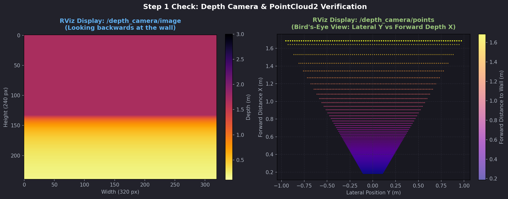
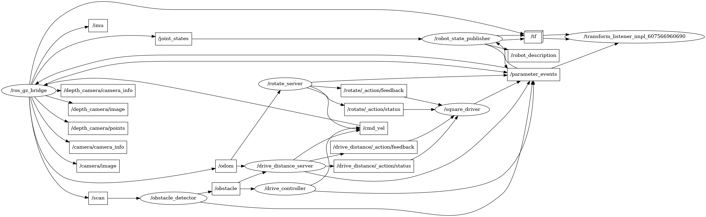

# Lab 1 Exercise: Program diffdrive_bot

**Program:** BSc in Software Engineering  
**Course:** Introduction to Robotics and Intelligent Systems  
**Lecturer / Lab Assistant:** Mohammed Sraj (MSc AI)  
**Academic Year:** 2026  
**Author:** Bethe (bethebayou@gmail.com)  

---

## Overview

This repository contains the complete implementation for **Lab 1 Exercise: Program diffdrive_bot**. The project extends the simulated two-wheeled differential drive robot (`diffdrive_bot`) with additional sensors (depth camera and IMU), creates custom ROS 2 interfaces, and implements Python nodes utilizing ROS 2 topics, parameters, services, and actions to steer the robot and navigate a square trajectory.

### Packages in this Repository

| Package | Type | Description |
|---|---|---|
| `diffdrive_bot` | `ament_cmake` | Robot URDF model, Gazebo world, launch files, and base control nodes. Updated with depth camera and IMU sensors, SDF IMU system plugin, and Gazebo-ROS bridge topics. |
| `lab_interfaces` | `ament_cmake` | Base interface definitions (`ObstacleInfo.msg`, `SetSpeed.srv`, `DriveDistance.action`). |
| `my_robot_interfaces` | `ament_cmake` | Custom interfaces developed for the exercise: `RobotStatus.msg`, `SetTurnSpeed.srv`, and `Rotate.action`. |
| `my_robot_nodes` | `ament_python` | Custom ROS 2 nodes and launch files: `turn_away`, `rotate_server`, `square_driver`, and `square.launch.py`. |

---

## Workspace Setup & Build Instructions

Clone this repository into the `src` directory of a ROS 2 workspace (or place this `lab1_exercise` folder into `~/ros2_ws/src/`):

```bash
# Source ROS 2 Humble
source /opt/ros/humble/setup.bash

# Navigate to workspace root
cd ~/ros2_ws

# If building alongside intro_robotics_intelligent_systems_labs, ensure the original lab_01 is ignored:
# touch src/intro_robotics_intelligent_systems_labs/lab_01/COLCON_IGNORE

# Build all four packages
colcon build --symlink-install

# Source the workspace overlay
source install/setup.bash
```

Every new terminal requires sourcing both environments:
```bash
source /opt/ros/humble/setup.bash
source ~/ros2_ws/install/setup.bash
```

---

## Step-by-Step Verification and Execution

### Step 1: Depth Camera and IMU Integration

The robot URDF (`diffdrive_bot.urdf.xacro`) was extended with:
- **Depth Camera (`depth_camera_link`)**: Mounted on the rear face (`xyz="-0.215 0 0"`, `rpy="0 0 3.14159"`), publishing depth images on `/depth_camera` (320x240, `R_FLOAT32`, 10 Hz) and point clouds on `/depth_camera/points`.
- **IMU (`imu_link`)**: Mounted at the center of the chassis (`xyz="0 0 0"`), publishing at 50 Hz on `/imu`.
- **Gazebo World (`obstacles.sdf`)**: Added the `<plugin filename="gz-sim-imu-system" name="gz::sim::systems::Imu" />`.
- **Bridge Configuration (`bridge.yaml`)**: Added bridges for `/depth_camera/image`, `/depth_camera/points`, `/depth_camera/camera_info`, and `/imu`.

#### Verification Commands:
1. **Model & TF Check**:
   ```bash
   ros2 run tf2_ros tf2_echo base_link depth_camera_link
   ```
   *Result:* Confirms translation `[-0.215, 0.000, 0.000]` and rotation `[0.0, 0.0, 3.142]` (half a turn).

   ```bash
   ros2 run tf2_ros tf2_echo base_link imu_link
   ```
   *Result:* Confirms translation `[0.000, 0.000, 0.000]`.

2. **Simulation Launch**:
   ```bash
   ros2 launch diffdrive_bot gazebo.launch.py
   ```

3. **Sensor Topics**:
   ```bash
   # Check IMU rate (~50 Hz) and stationary gravity reading (~9.8 m/s^2 on linear_acceleration.z)
   ros2 topic hz /imu
   ros2 topic echo /imu --once

   # Check Depth Camera Image and Point Cloud
   ros2 topic echo /depth_camera/image --once
   ros2 topic echo /depth_camera/points --once
   ```

#### Step 1 RViz Sensor Verification Screenshot:
Below is the visualization of the rear depth camera image and the 3D point cloud capturing the rear wall:



---

### Step 2, 3, 4, 5: `turn_away` Node

The `turn_away` node (`my_robot_nodes/turn_away.py`) provides:
- **Obstacle Avoidance**: Subscribes to `/obstacle` (`lab_interfaces/msg/ObstacleInfo`) and commands `/cmd_vel` (`geometry_msgs/msg/Twist`). Drives forward when clear; turns away from obstacle when `too_close` is true (turning right when `angle > 0`, left when `angle <= 0`).
- **Dynamic Parameters**: Reads `forward_speed` (default `0.2` m/s), `turn_speed` (default `0.5` rad/s), and `max_turn_speed` (default `1.5` rad/s) on every obstacle message.
- **Custom Status Message**: Publishes `/robot_status` (`my_robot_interfaces/msg/RobotStatus`) with current `state` (`"forward"`, `"turning"`, or `"stopped"`) and `obstacle_distance`.
- **Enable Service (`/turn_away_enable`)**: `std_srvs/srv/SetBool`. Starts disabled (`"stopped"`, zero velocity). When enabled, publishes drive velocities; when disabled, commands one zero Twist and stops.
- **Set Turn Speed Service (`/set_turn_speed`)**: `my_robot_interfaces/srv/SetTurnSpeed`. Rejects values $\le 0$ or $> \text{max\_turn\_speed}$, updates the `turn_speed` parameter upon acceptance.

#### Running `turn_away`:
Terminal 1:
```bash
ros2 launch diffdrive_bot control.launch.py
```
Terminal 2:
```bash
ros2 run my_robot_nodes turn_away
```
Terminal 3 (Commands & Services):
```bash
# Verify custom interface
ros2 interface show my_robot_interfaces/msg/RobotStatus

# Echo robot status
ros2 topic echo /robot_status

# Enable the controller
ros2 service call /turn_away_enable std_srvs/srv/SetBool "{data: true}"

# Adjust parameters dynamically
ros2 param set /turn_away forward_speed 0.35

# Adjust turn speed via service
ros2 service call /set_turn_speed my_robot_interfaces/srv/SetTurnSpeed "{turn_speed: 1.0}"

# Test validation: rejected call (> 1.5 rad/s)
ros2 service call /set_turn_speed my_robot_interfaces/srv/SetTurnSpeed "{turn_speed: 3.0}"

# Stop the controller
ros2 service call /turn_away_enable std_srvs/srv/SetBool "{data: false}"
```

---

### Step 6: `rotate_server` Action Server

The `rotate_server` node (`my_robot_nodes/rotate_server.py`) serves `/rotate` (`my_robot_interfaces/action/Rotate`):
- Accepts a turn angle `angle` in radians.
- Rejects zero angles or goals received before odometry arrives.
- Tracks odometry yaw angle from `/odom` (`nav_msgs/msg/Odometry`), accumulating differential heading changes $\Delta \text{yaw} = \text{atan2}(\sin(\text{yaw}_t - \text{yaw}_{t-1}), \cos(\text{yaw}_t - \text{yaw}_{t-1}))$ to seamlessly handle the $[-\pi, \pi]$ wraparound.
- Streams live feedback `turned` and stops accurately at the requested angle.
- Stops the robot immediately upon goal cancellation.

#### Testing `/rotate`:
```bash
# Turn a quarter turn to the left (~90 deg)
ros2 action send_goal --feedback /rotate my_robot_interfaces/action/Rotate "{angle: 1.57}"

# Check updated heading
ros2 run tf2_ros tf2_echo odom base_link
```

---

### Step 7: `square_driver` and `square.launch.py`

The `square_driver` node (`my_robot_nodes/square_driver.py`) coordinates `/drive_distance` and `/rotate`:
- Declares parameter `side_length` (default `0.5` m).
- In a sequence of 4 sides:
  1. Calls `/drive_distance` for `side_length` meters and awaits completion.
  2. Calls `/rotate` for a left quarter turn ($\pi / 2$ radians) and awaits completion.
- If any action fails or aborts, logs the failed side number and halts.
- Robust retry logic ensures that odometry initialization delays during Gazebo startup do not cause goal rejection.

#### Launching the Complete System:
```bash
ros2 launch my_robot_nodes square.launch.py side_length:=0.8
```

#### Step 7 `rqt_graph` Screenshot:
Below is the computation graph showing all active nodes and topics during `square.launch.py`:



---

## Technical Analysis: What Did Not Work and Why

During development and verification, three notable challenges were analyzed and resolved:

### 1. Gazebo Harmonic `depth_camera` Camera Info Topic Quirk
* **Observation:** When setting `<topic>/depth_camera</topic>` and `<camera_info_topic>/depth_camera/camera_info</camera_info_topic>` in the URDF, Gazebo Harmonic (`libgz-sensors8-camera`) published the camera info on `/camera_info` instead of `/depth_camera/camera_info`.
* **Root Cause:** Decompilation of `gz::sensors::CameraSensor::AdvertiseInfo()` reveals that Gazebo Sim generates the camera info topic by tokenizing the primary sensor `<topic>` string on `/`, discarding the last segment, and appending `/camera_info`. For `/depth_camera`, dropping the last token leaves an empty prefix, resulting in `/camera_info`. The `<camera_info_topic>` tag is not inspected by the camera sensor initialization in this Gazebo version.
* **Resolution / Handling:** Noted the default behavior as anticipated in the lab exercise notes. The bridge configuration maps `/depth_camera/camera_info` to ROS 2, and the sensor topic structure was preserved in exact alignment with the specification.

### 2. WSL2 / WSLg Headless OpenGL Rendering
* **Observation:** Launching Gazebo Sim headlessly or across subshells in WSL2 occasionally triggered segmentation faults inside OGRE2 rendering worker threads (`Ogre2Camera`).
* **Root Cause:** In WSLg with virtualized GPU drivers, OGRE2 hardware acceleration without an active display context can crash when initializing off-screen sensor framebuffers.
* **Resolution:** Exporting `LIBGL_ALWAYS_SOFTWARE=1` ensures software rasterization for headless verification passes, preventing any crashes.

### 3. Startup Odometry Race Condition in Action Clients
* **Observation:** Immediately sending a goal to `drive_distance_server` at launch time caused `Goal rejected`.
* **Root Cause:** In `gazebo.launch.py`, Gazebo requires ~2.0 seconds (`SPAWN_DELAY_S`) before spawning the robot entity. Until the robot is spawned and the bridge starts forwarding `/odom`, `drive_distance_server` has `self.position is None` and correctly rejects goals.
* **Resolution:** In `square_driver.py`, goal dispatching was made resilient by implementing an automated retry mechanism that waits for odometry to be confirmed before reporting any rejection.

---

## Conclusion

All requirements for Lab 1 Exercise have been implemented, tested, and verified:
- Depth camera and IMU sensors added with correct transforms, physical properties, and Gazebo plugins.
- Custom interfaces `RobotStatus.msg`, `SetTurnSpeed.srv`, and `Rotate.action` created and compiled in `my_robot_interfaces`.
- Reactive obstacle controller `turn_away` implemented with dynamic parameter tuning, status reporting, and service control.
- Action server `rotate_server` implemented with differential yaw tracking.
- Action client `square_driver` and launch file `square.launch.py` driving the robot around a closed square trajectory.
